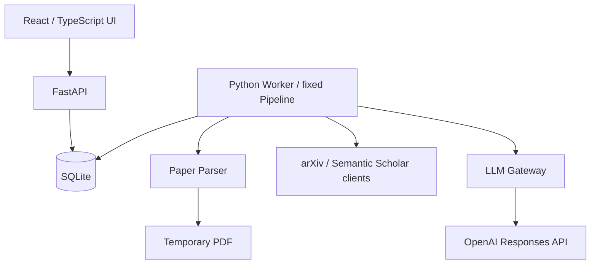

# System Architecture

Status: Canonical design baseline. Updated: 2026-09-19.
プロダクト仕様は [requirements.md](requirements.md) を正とする。
技術選定と運用上限は個人開発MVPの実装初期設定であり、ユーザー確定Decisionと区別する。

## 1. 最小構成



同じコードベースをAPIとWorkerの別プロセスで実行するモノリス。
単一ホスト・Job同時実行1件から始める。Redis、Vector DB、Agent Framework、Kubernetesは導入しない。

| 責務 | 初期選定 | 理由 |
|---|---|---|
| Backend | Python / FastAPI / Pydantic | Parser・評価と共通言語、API/LLM出力の型検証 |
| Frontend | React / TypeScript / Vite | 分岐Graph、選択状態、説明パネル。SSRは不要 |
| DB | SQLite / SQLAlchemy / Alembic | 単一ホストの低同時実行、schema migration |
| Async Job | DB-backed queue / 専用Worker | 再起動後の復旧。API内メモリqueueだけに依存しない |
| Parser | pdfplumberを第一候補に品質検証 | ページ・文字位置・表抽出。Section認識は別処理 |
| Academic API | HTTPX専用client | timeout、rate limit、batch、cacheを管理 |
| Pipeline | 固定Python stage関数 | 分岐・停止条件をコードで制御 |
| Cache | SQLite | 小規模なAPI応答とstage結果の再利用 |
| Graph UI | React＋SVG | 小さいGraphを表示。汎用Graph編集機能は不要 |
| Observability | JSON logging＋DB実行履歴 | stage別の費用・時間・失敗理由を追跡 |

ParserはPhase 1の代表論文で確定する。品質不足なら比較検証し、仕様を満たせない抽出を成功扱いしない。
SQLiteはWAL、短いtransaction、busy timeoutを使い、network filesystem上で共有しない。
将来複数ホストが必要になった場合のみDB・queue構成を再検討する。

## 2. Pipeline

```text
Paper retrieval → Parsing → Contribution/Problem extraction
→ Reference/Candidate retrieval → Metric calculation / InitialScore
→ Top 10 Contribution evaluation → FinalScore → Lineage construction / validation
→ Reasoning Flow → Concept necessity → Knowledge generation → Persist results
```

取得・正規化・数値計算・Graph制約・引用照合は決定的処理。
抽出・分類・意味的関係・説明は [LLM仕様](llm-execution-spec.md) の担当modelで行う。
LLMが次のツールや探索回数を自由に決める構造にはしない。
Lineage失敗後もTarget本文があればReasoningを続行できる。Knowledgeは有効なReasoningに依存する。

## 3. JobとAPI

状態名は要件と共通:

```text
queued → parsing → retrieving_candidates → ranking_candidates
→ building_lineage → building_reasoning → building_knowledge → completed
terminal alternatives: failed / partial_completed
```

Paper retrievalはparsingのsubstage、Contribution抽出等もStageExecutionで個別管理する。
機能別status・現在stage・失敗理由を保持し、全体statusだけで全機能の成否を表さない。
全stageが終わればcompleted。正常に判定したinsufficient_evidenceは実行障害とは別。
利用できる解析機能を残したstage障害はpartial_completed、利用可能な解析結果なしはfailed。

Workerは短いtransactionでJobをclaimし、lease/heartbeat/ownerを保存。
stageごとに入力hashとcheckpointを保存し、結果保存を冪等化する。
再起動時はlease切れJobだけ回収。成功stage・使用済みattempt・費用予約を保持する。
外部APIの応答喪失に対するexactly-once課金は保証しない。

初期API契約:

| Endpoint | 内容 |
|---|---|
| POST /analyses | arXiv URLを検証、解析Job作成、202とjob_id/paper_idを返す |
| GET /analyses/{job_id} | 全体・機能別状態、費用、時間、不足理由 |
| GET /analyses/{job_id}/lineage | 当該解析版のLineage |
| GET /analyses/{job_id}/reasoning | 当該解析版のReasoning＋短いKnowledge |
| POST /analyses/{job_id}/knowledge/{item_id}/detail | 詳細生成Jobまたは既存cacheを返す |
| GET /papers/{paper_id} | metadata、版、解析履歴、累計費用 |

解析版が混ざらないよう結果取得はjob_idで固定する。UIはpollingから始める。
同一fingerprintの進行中Jobは共有し、同じクリックで二重課金しない。

## 4. Domainと保存

| Model | 主なデータ |
|---|---|
| Paper / ExternalIds | title、authors、abstract、各外部ID、日付根拠 |
| PaperRevision | arXiv version、content hash、取得元、parser version |
| PaperSection | revision、section、page、text、順序、span、抽出品質 |
| Reference | 文献表表記、引用元、解決先Paper、解決状態 |
| Contribution | Targetの主張、Claim/Evidence参照、最大3件 |
| CandidateEvaluation | 探索元、metric値/null理由、coverage、score、除外理由 |
| ResearchLineage / LineageNode / LineageEdge | 解析版、論文参照、関係、根拠、Confidence内訳 |
| ReasoningFlow / ReasoningStep / ReasoningEdge | 最大10Step、8 type、3 relation、分岐 |
| KnowledgeItem | concept、必要度、why、短文/詳細、Stepと必要性を判断したEdge |
| Claim | 主張、日本語説明、著者の主張/システム解釈、status |
| Source / Evidence | 取得URL/版/hash、英語引用span、ページ、検証結果 |
| AnalysisJob / StageExecution | 状態、fingerprint、checkpoint、attempt、lease、時刻 |
| LLMExecution | model、versions、token、推定費用、latency、validation |

ExternalIdsは値オブジェクト。Graph結果は検証済みJSONで保存可能で、全Entityを独立tableにしない。
Paper、revision、sections、sources、jobs、executions、cacheは検索・整合性上必要な単位で分離する。
詳細DDLはPhase 0で作成する。

Reasoning Step types: problem / observation / hypothesis / approach / experiment / result / interpretation / conclusion。
Edge types: leads_to / evaluates / supports。方向は要件の例に合わせ、例えばApproach→Experimentをevaluatesとする。
Knowledgeの必要度は0:不要、1:あるとよい、2:重要、3:Step間の論理理解に不可欠。表示は3のみ。

## 5. 外部取得・保存・cache

arXiv clientはmetadataと対象版PDF、S2 clientはReferences、Recommendations、取得可能な引用文脈・embeddingを担当。
APIで得られた項目をLLMで上書きしない。missingは推測せず記録する。
APIごとにrate limiterを置き、429・Retry-After、timeout、最大attemptを扱う。
制約はAPI実装時に公式資料で再確認し、設定化する。LLMとAcademic APIのattempt集計を混同しない。

PDFは一時ファイルとし、成功・失敗時のfinallyと起動時の残骸清掃で削除する。
公開arXivのSection本文はDBへ永続保存する。ログには出さない。
非arXiv本文の永続保存権限は今回のDecisionから拡張解釈せず、MVPでは必要なEvidence抜粋・metadataのみ保持する。
Source本文が手元にない再検証は必要時に再取得し、取得不能なら検証不能とする。

API cacheは取得日時・TTLを持つ。初期TTLはmetadata/引用指標24時間、失敗・not foundは5分。
版固定されたSection本文はTTLで削除しない。parser更新時は再解析版を作り既存spanを上書きしない。
stage cacheは [LLM仕様](llm-execution-spec.md) のfingerprintを使用する。

## 6. Background Knowledgeの限定取得

Source優先順位はTarget → Related Paper → Author/Project official → 信頼できるAcademic/Technical source。
取得済みの論文spanを先に使う。足りない場合のみ、論文/APIから得た公式URLまたは
事前登録の学術・技術資料URLを取得する。LLMに新URLを作らせない。
MVPの初期設定は外部説明資料最大3件/Job、リンク再帰探索なし、汎用Web Searchなし。
allowlistの具体的URL・ドメインはPhase 4で確定し、空の間は外部資料取得を無効化する。
十分なSourceがなければ不足を表示し、一般知識を出典付きであるかのように生成しない。
URLの接続先・redirectを検証し、private networkへの取得や無制限downloadを防ぐ。

## 7. Repository責務

```text
src/paper_review/
  domain/                 models、Evidence、Graph制約
  application/            use cases、ports
  pipeline/               runner、stages、ranking、context選択
  llm/                    gateway、schemas、prompts
  infrastructure/
    database/             永続化、migration補助、cache
    parsing/              Parser adapter
    academic_api/         arXiv、Semantic Scholar
    llm/                  OpenAI adapter
    observability.py
  api/                    HTTP schema/routes
  worker.py
  bootstrap.py
frontend/
migrations/
tests/{unit,integration,fixtures}/
evaluation/{manifest,annotations,reports}/
docs/
ADR/
```

これは予定構成。今回コードは作成しない。domainは外部SDKをimportせず、bootstrapがportとadapterを接続する。
全クラスにinterfaceを設けるような過剰な階層化はしない。

## 8. ObservabilityとPhase

JSON logはjob/stage/attempt IDs、status、時刻、API error種別、token、推定cost、retry回数を含む。
body・秘密値・raw prompt/responseは含めない。表示用EvidenceはDBから取得する。
queue wait、実行時間、全体経過時間、外部API latency、cache hit、LLM費用を別々に測る。

| Phase | 完了時の確認 |
|---|---|
| 0 Skeleton | API→DB queue→fake Worker→結果取得、再開、ログ、fake LLM validation |
| 1 Retrieval/Parsing | 対象版のSection/References/原文位置、PDF削除 |
| 2 Research Lineage | 補正policy確定後、最小系列→深度・合流・Confidence |
| 3 Reasoning Flow | 最大10Stepの分岐Graphと原文参照 |
| 4 JIT Knowledge | 必須概念、短文、要求時詳細、別費用記録 |
| 5 Evaluation/Reliability | 10論文、baseline、障害・再開、費用・時間 |
| 6 UI refinement | 日本語UI、英語引用、部分成功・不確実性を理解できる表示 |

Phase 0は開始可能。未決項目をfakeで切り離し、Stage 2の未承認補正を実装済み仕様にしない。
公開deployment・認証方式はPhase 0のローカル構築を妨げず、外部公開前に決める。
